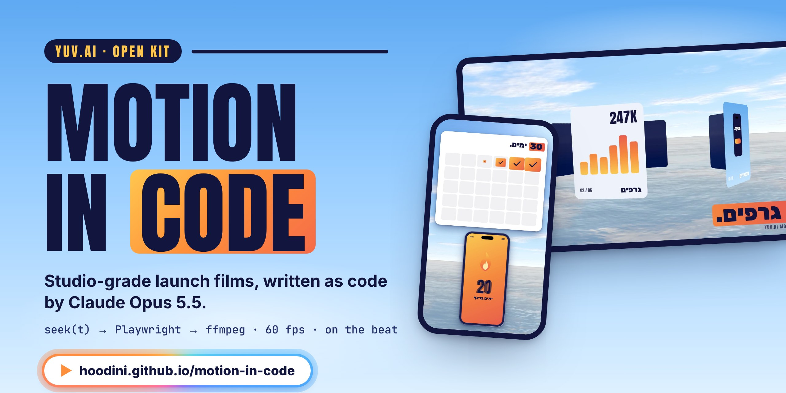
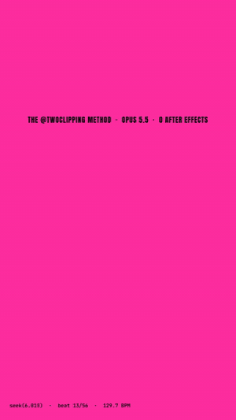
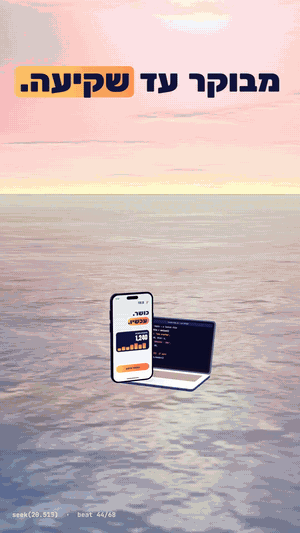
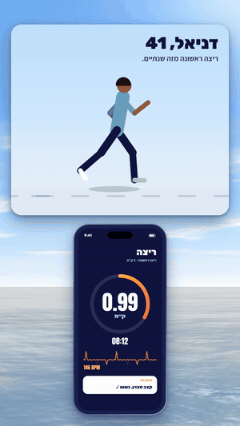
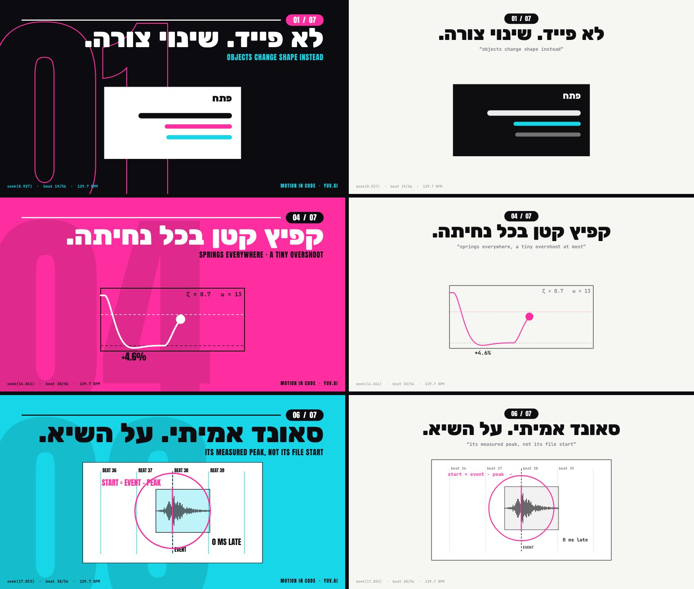
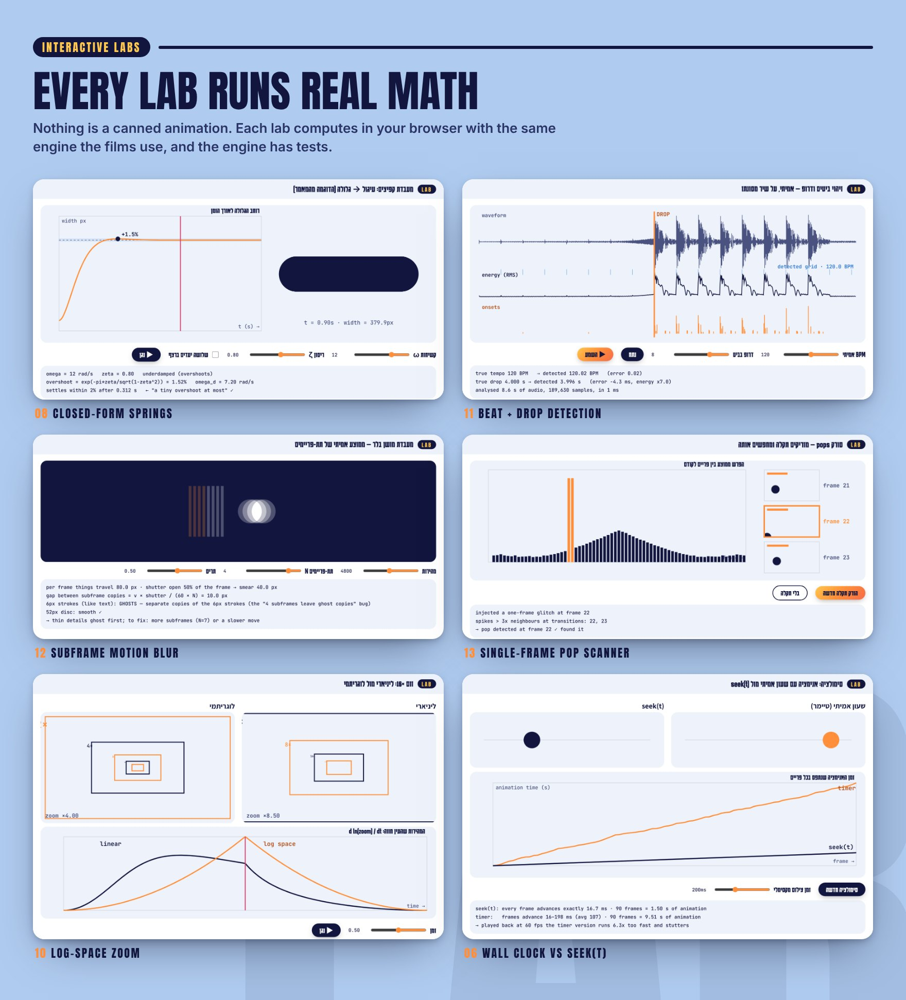

<p align="center">
  <a href="https://hoodini.github.io/motion-in-code/"></a>
</p>

<p align="center">
  <a href="https://hoodini.github.io/motion-in-code/"></a>
  
  
</p>

No After Effects and no timeline editor. Every frame of these films is a pure function of time, `seek(t)`, written by Claude Opus 5.5, captured by Playwright at 60 fps and assembled by ffmpeg, with real music and sound effects landing on the beat.

This repo holds four things:

- **[The page](https://hoodini.github.io/motion-in-code/)**: a Hebrew deep dive into the method, in 19 chapters with 16 live labs.
- **[The catalog](https://hoodini.github.io/motion-in-code/catalog.html)**: 18 live building blocks you can ask Claude for, each explained from zero with a full prompt, plus a prompt builder.
- **[The films](#-the-films)**: three finished films made with the method, each in 9:16 and 16:9.
- **[The kit](#-the-kit)**: the open code behind the films.

<p align="center">
  <a href="media/yuv-motion-launch-16x9.mp4"></a>
  <br>
  <sub><b>YUV.AI MOTION</b> · the click bursts into a 3D carousel that snaps on every beat. Every pixel here is code.</sub>
</p>

## ▶ The films

All three are 1080p at 60 fps with subframe motion blur, scored with real music and SFX placed by their measured peak. Click a preview to open the full MP4.

<p align="center">
  <a href="media/motion-in-code-9x16.mp4"></a>&nbsp;&nbsp;
  <a href="media/yuv-motion-launch-9x16.mp4"></a>&nbsp;&nbsp;
  <a href="media/ketzev-fitness-9x16.mp4"></a>
</p>

| Film | What it is | Length | Watch |
|---|---|---|---|
| **Motion in Code** | The first film: the method's rules, demonstrated in 27 seconds. | 26.7 s · 1,602 frames · −13.6 LUFS | [9:16](media/motion-in-code-9x16.mp4) · [16:9](media/motion-in-code-16x9.mp4) |
| **YUV.AI MOTION** | A launch film: neon prompt, 16th-note typing, 3D carousel, iPhone and MacBook, day-to-sunset time-lapse. | 32.7 s · 1,960 frames · 66 SFX on the beat | [9:16](media/yuv-motion-launch-9x16.mp4) · [16:9](media/yuv-motion-launch-16x9.mp4) |
| **קצב · Ketzev** | A product story for a fictional fitness app: the problem, the drop, a tour of the app, people training in sync, proof, CTA. | 40.1 s · 84 beats | [9:16](media/ketzev-fitness-9x16.mp4) · [16:9](media/ketzev-fitness-16x9.mp4) |

### A lesson the original article skips

The first version worked technically and still looked anemic. The second changed not one second of timing, only the art direction: full-bleed colour spreads, magazine-scale type and giant folio numerals. The method gives you studio motion and timing; taste has to be written into the brief.

<p align="center"></p>

## 📖 The page

<p align="center"><a href="https://hoodini.github.io/motion-in-code/"></a></p>

<p align="center"><a href="https://hoodini.github.io/motion-in-code/"></a></p>

## 🗂 The catalog

**[hoodini.github.io/motion-in-code/catalog.html](https://hoodini.github.io/motion-in-code/catalog.html)** is a live catalog of the building blocks you can ask Claude to put in a motion film, written in Hebrew for people who have never opened After Effects.

<p align="center"><a href="https://hoodini.github.io/motion-in-code/catalog.html"></a></p>

| Chapter | What's inside |
|---|---|
| 00 · Foundations | Nine concepts from zero (frames, HTML/CSS/JS, libraries and licences, React, vector vs raster, DOM vs Canvas vs WebGL, the `t` clock, springs, the six-block prompt), with four measuring labs |
| 01 · Data | Real **Recharts** area and bar charts, count-up KPIs, an SVG progress ring |
| 02 · UI | An app tour built from real **shadcn/ui** components, every one controlled from `t` |
| 03 · Icons & logos | Self-drawing **Lucide** icons and official logos from **Simple Icons**, with the trademark rules |
| 04 · Kinetic type | Slam, mask rise, pop typing and marker, with the Hebrew RTL details |
| 05 · 3D | **three.js** phone and laptop with live screens, a liquid glass orb, 20,000-particle morphs, an ocean time-lapse, a beat-snapping carousel, an instanced equalizer |
| 06 · Effects | The neon "AI is thinking" edge, frosted glass, an aurora with grain, four transitions without a crossfade |
| 07 · Tools map | Remotion, HyperFrames, GSAP, Motion Canvas, Lottie, Rive, Spline and React Three Fiber, with licences checked |
| 08 · Prompt builder | Pick elements, format, length and brand, and get one complete prompt for the whole film |

Every demo is a pure function of time with a scrubber under it, so the same code can be captured frame by frame into a video. The catalog source is in [`catalog-src/`](catalog-src/):

```bash
cd catalog-src
npm i
node build.mjs                 # -> ../catalog/ (code-split per demo) and catalog.html's CSS
```

## 🧪 The labs

<p align="center"><a href="https://hoodini.github.io/motion-in-code/#s8"></a></p>

Each lab computes live in the browser with [`engine/engine.js`](engine/engine.js), the same math the films use. The engine has tests:

```bash
node engine/test_engine.js
```

## ⚙️ How it works

1. **The film is one HTML file.** It exposes `seek(t)`, which paints the frame for time `t` from `t` alone, with no timers and no state between frames.
2. **Playwright captures every frame.** For motion blur it captures 6 to 8 subframes per frame across half a frame's time.
3. **ffmpeg assembles the film.** `tmix` blends the subframes into 60 fps, and loudnorm brings the audio to −14 LUFS.
4. **The music is the clock.** The beat grid and the drop are measured first. Something happens on every beat, and every SFX is placed so its peak lands on its event.

```js
const spring = (t, w = 12, z = 0.8) => { if (t <= 0) return 0;
  const wd = w * Math.sqrt(1 - z * z);
  return 1 - Math.exp(-z * w * t) * (Math.cos(wd * t) + (z * w / wd) * Math.sin(wd * t)); };

window.seek = (t) => {                  // t in seconds. Nothing else.
  const grow = spring(t - 0.5);          // starts growing at 0.5 s
  dot.style.width = 44 + (380 - 44) * grow + 'px';   // circle (44px) -> pill (380px)
};
```

## 🧰 The kit

[`kit/`](kit/) is the code behind the films: 2D on canvas, 3D with three.js, one clock.

| Module | What's inside |
|---|---|
| `src/core.js` | closed-form springs, sum-of-springs, log zoom, brand themes, type, colour spreads, render API |
| `src/ui.js` | cards with depth, neon edges, slam type, popping typing, cursor and click, chips, counters, bars |
| `src/world.js` | procedural phone and laptop with live screens, 3D cards, day-to-sunset sky shader, ocean |
| `src/people.js` | people drawn in code: squat, run, push-up and sit-with-phone poses |
| `films/` | `launch`, `fitness` and `kit-demo` sources |
| `qa/qa.py` | stills, a per-beat contact sheet, and a single-frame pop detector |
| `render/` | Playwright → ffmpeg segments, parallel workers, score mixing |

```bash
cd kit
npm i
node build.mjs kit-demo        # -> films/kit-demo/film.html
```

Open `films/kit-demo/film.html?L=h` (or `?L=v`) and call `seek(3.2)` in the console to scrub. The full workflow, including rendering and scoring, is in [`kit/README.md`](kit/README.md).

The brand logos are private, so a fresh clone builds without them. Mixkit music files are never committed; the films use them under Mixkit's licence.

## 🙏 Credits

The method, the original article and its prompts belong to **zero ([@twoclipping](https://x.com/twoclipping))**. The page is an analysis and Hebrew translation for learning.

<br>

<p align="center">
  <b>Yuval Avidani</b> · AI commentator on Channel 12 News · 2× GitHub Star · AWS Gen AI Superstar · founder of YUV.AI
  <br><br>
  <a href="https://yuv.ai">yuv.ai</a> ·
  <a href="https://linktr.ee/yuvai">Linktree</a> ·
  <a href="https://x.com/yuvalav">X</a> ·
  <a href="https://instagram.com/yuval_770">Instagram</a> ·
  <a href="https://www.tiktok.com/@yuval.ai">TikTok</a> ·
  <a href="https://youtube.com/@yuv-ai">YouTube</a> ·
  <a href="https://www.linkedin.com/in/yuval-avidani-87081474/">LinkedIn</a>
</p>
